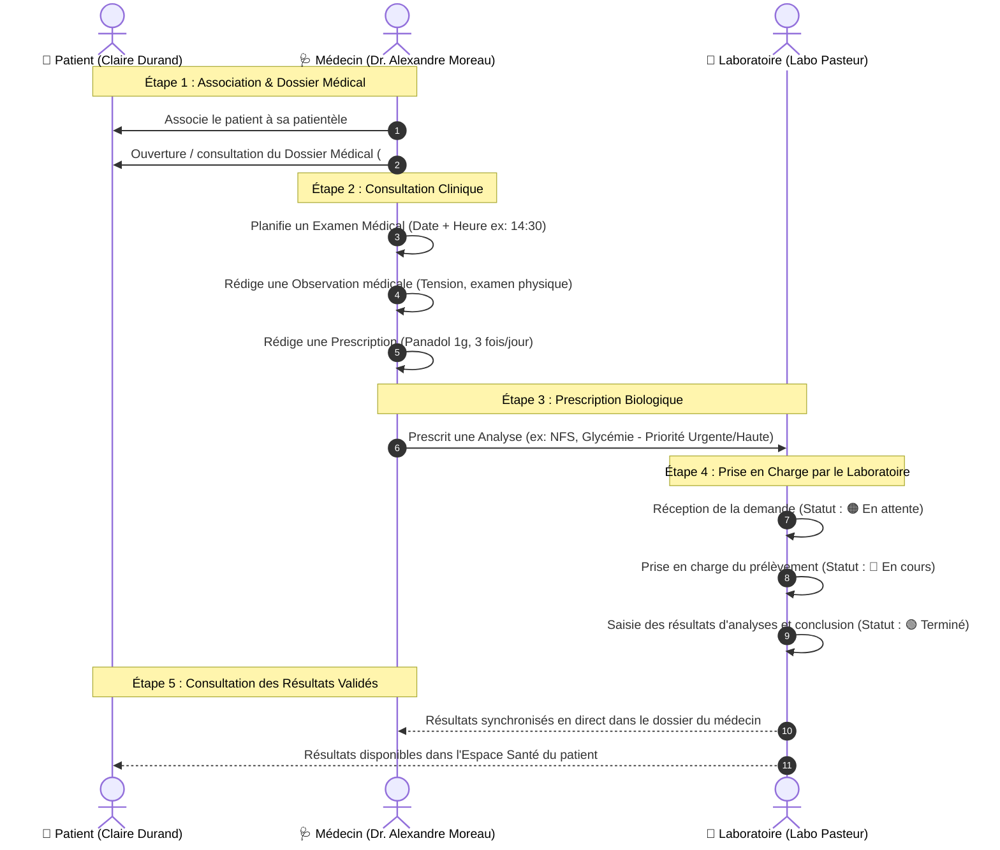
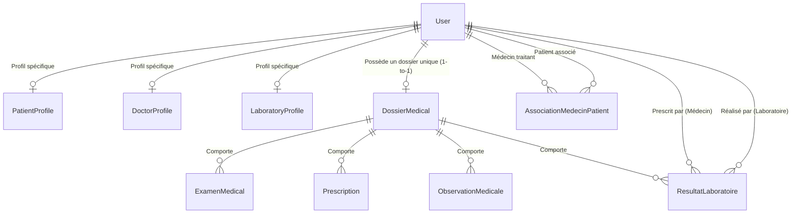

# 📘 Guide Complet : Module Gestion des Patients & Parcours Médical — SantéConnect

Ce document décrit en détail le fonctionnement, les relations de données, le scénario de démonstration et l'emplacement exact de tous les **CRUD** du module **Gestion des Patients** de l'application **SantéConnect**.

---

## 1. 🔄 Scénario Complet de Démonstration (Démarche Pas à Pas)

Ce scénario illustre le parcours de soins collaboratif entre un **Médecin** (Dr. Alexandre Moreau), un **Patient** (Claire Durand) et un **Laboratoire d'analyses** (Laboratoire Pasteur).

### Déroulement pratique sur l'application :
1. **Connexion Médecin (`dr_moreau`)** sur `http://127.0.0.1:8000/dashboard/docteur/` :
   * Il consulte sa liste de patients suivis.
   * Il clique sur **« 📁 Dossier »** du patient (ex: Claire Durand).
2. **Consultation & Actions dans le Dossier Patient** :
   * **Ajout d'examen** : bouton `🩺 Examen` ➔ titre, type, date, saisie libre de l'heure (`14:30`), motif.
   * **Prescription** : bouton `💊 Prescription` ➔ médicament, posologie, durée, instructions.
   * **Observation** : bouton `📝 Observation` ➔ compte-rendu d'observation clinique.
   * **Prescription d'analyse** : bouton `🔬 Prescrire Analyse` ➔ choix de l'analyse, niveau de priorité (*Normale*, *Haute*, *Urgente*) et sélection du laboratoire.
3. **Traitement par le Laboratoire (`lab_pasteur`)** sur `http://127.0.0.1:8000/dashboard/laboratoire/` :
   * La demande s'affiche immédiatement dans le tableau avec sa référence et sa priorité.
   * Le biologiste clique sur **`👁️ Ouvrir`** pour lire la demande.
   * Il clique sur **`📝 Saisir résultat`**, renseigne les valeurs mesurées, son commentaire et valide le statut en **`🟢 Terminé`**.
4. **Consultation par le Patient (`patient_durand`)** sur `http://127.0.0.1:8000/dashboard/patient/` :
   * Le patient consulte ses ordonnances actives, ses rendez-vous et télécharge ses résultats d'analyses.

---

## 2. 🧬 Modèle Conceptuel et Relations de Données (MCD)

Toutes les entités sont implémentées dans `accounts/models.py` :

### Description des relations :
* **`User` (Rôles)** : Utilisateur central avec rôle (`DOCTEUR`, `PATIENT`, `LABORATOIRE`, `ADMIN`).
* **`DossierMedical` (`OneToOneField` vers `User` Patient)** :
  * Clé de voûte médicale contenant le numéro de dossier unique (`DM-XXXXXX`), groupe sanguin, allergies et antécédents.
* **`AssociationMedecinPatient` (`ForeignKey` Médecin + `ForeignKey` Patient)** :
  * Gère la relation médecin traitant référent et autorise l'accès au dossier médical.
* **`ExamenMedical`** :
  * Rattaché au `DossierMedical` et au `User` (Médecin praticien).
* **`Prescription` (Ordonnance)** :
  * Rattachée au `DossierMedical` et au `User` (Médecin prescripteur).
* **`ObservationMedicale`** :
  * Rattachée au `DossierMedical` et au `User` (Médecin auteur), avec gestion de la confidentialité.
* **`ResultatLaboratoire`** :
  * Rattaché au `DossierMedical`, au Médecin prescripteur et au Laboratoire réalisateur.

---

## 3. 🛠️ Répertoire Exhaustif des CRUD (Où trouver chaque élément)

### Tableau complet Code, Formulaires, Modales et URLs :

| Entité | Opération CRUD | Fichier Python & Fonction Backend | Formulaire Django | Template HTML & Emplacement UI | Route URL |
| :--- | :--- | :--- | :--- | :--- | :--- |
| **🩺 Examen Médical** | **C**reate **R**ead **U**pdate **D**elete | `accounts/views.py` : • `add_examen` • `get_examen_detail` • `edit_examen` • `delete_examen` | `accounts/forms.py` : `ExamenMedicalForm` | `templates/accounts/doctor_patient_dossier.html` • Bouton `🩺 Examen` • Modale `#modal-add-exam` • Icônes `✏️` et `🗑️` | `/docteur/patient/<id>/examen/add/` `/api/examen/<id>/` `/docteur/examen/<id>/edit/` `/docteur/examen/<id>/delete/` |
| **💊 Prescription (Ordonnance)** | **C**reate **R**ead **U**pdate **D**elete | `accounts/views.py` : • `add_prescription` • `get_prescription_detail` • `edit_prescription` • `delete_prescription` | `accounts/forms.py` : `PrescriptionForm` | `templates/accounts/doctor_patient_dossier.html` • Onglet Prescriptions • Bouton `+ Ajouter` • Modale `#modal-add-presc` | `/docteur/patient/<id>/prescription/add/` `/api/prescription/<id>/` `/docteur/prescription/<id>/edit/` `/docteur/prescription/<id>/delete/` |
| **🔬 Analyse Biologique & Labo** | **C**reate (Prescrire) **R**ead (Détails) **U**pdate (Saisie Labo) **D**elete | `accounts/views.py` : • `add_resultat` • `get_resultat_detail` • `lab_update_resultat` • `delete_resultat` | `accounts/forms.py` : `ResultatLaboratoireForm` | 1. Côté Médecin : `doctor_patient_dossier.html` Bouton `🔬 Prescrire Analyse`  2. Côté Laboratoire : `dashboard_lab.html` Boutons `👁️ Ouvrir` et `📝 Saisir résultat` | `/docteur/patient/<id>/resultat/add/` `/api/resultat/<id>/` `/labo/resultat/<id>/update/` `/docteur/resultat/<id>/delete/` |
| **📝 Observation Médicale** | **C**reate **R**ead **U**pdate **D**elete | `accounts/views.py` : • `add_observation` • `get_observation_detail` • `edit_observation` • `delete_observation` | `accounts/forms.py` : `ObservationMedicaleForm` | `templates/accounts/doctor_patient_dossier.html` • Onglet Observations • Bouton `📝 Observation` • Modale `#modal-add-obs` | `/docteur/patient/<id>/observation/add/` `/api/observation/<id>/` `/docteur/observation/<id>/edit/` `/docteur/observation/<id>/delete/` |
| **👤 Patient & Association** | **C**reate (Associer) **R**ead (Dossier) **U**pdate (Info profil) **D**elete (Dissocier) | `accounts/views.py` : • `associer_patient` • `doctor_patient_dossier` • `patient_edit_info` • `dissocier_patient` | `accounts/forms.py` : • `PatientProfileForm` • `AssociationForm` • `DossierMedicalForm` | `templates/accounts/dashboard_doctor.html` • Bouton `+ Associer un patient` • Tableau des patients suivis | `/docteur/patient/associer/` `/docteur/patient/<id>/dossier/` `/docteur/patient/<id>/dissocier/` `/profile/` |

---

## 4. 🤖 2. IA — Analyse Intelligente du Dossier Médical

Ce module d'intelligence artificielle clinique valide scrupuleusement les trois éléments fondamentaux de l'analyse :

### 1. 🩺 Récupération complète des examens
* Récupération de la **liste complète des examens** associés au patient (et pas uniquement leur simple comptage numérique).
* Modèle de données exposé : chaque examen fournit son titre, son type spécialisé, sa date, son heure, son statut, son motif et son compte-rendu médical s'ils existent.

### 2. 🧠 Génération du résumé NLP
* Intégration systématique et détaillée dans le compte-rendu narratif :
  * Le **type d'examen** (ex: *Coloscopie*, *Scanner TAP*, *Échocardiographie*)
  * La **date** et l'heure (ex: *le 17/09/2026 à 14:30*)
  * Le **statut** (ex: *Terminé*, *Planifié*, *En cours*)
  * Le **motif / description clinique** lorsqu'il existe
  * Le **compte-rendu médical / résultat** lorsqu'il existe (ex: *TA 138/88 mmHg, ECG normal, absence de lésion décelable*)
* Fourniture d'un bouton interactif **« 📋 Copier la synthèse »** pour transférer l'analyse textuelle dans les observations du praticien.

### 3. 🔬 Extraction des entités & Détection de polarité clinique (NegEx)
* Analyse sémantique poussée des descriptions d'examens et des observations cliniques.
* Distinction stricte et traçable entre :
  * 🔴 **Informations Avérées (Positif)** : Allergies actives, comorbidités confirmées, antécédents positifs.
  * 🟢 **Informations Explicitement Négatives / Écartées (Négation clinique)** : Détection des marqueurs de négation (*« pas d'allergie »*, *« absence de diabète »*, *« aucun antécédent d'HTA »*, *« nie toute douleur »*, *« néant »*, *« ras »*). Ces informations ne pénalisent pas le score de risque et rassurent le praticien.
  * ⚪ **Informations Absentes** : Pathologies ou facteurs non documentés dans le dossier.
* Endpoints API dédiés : `/api/dossier/<patient_id>/analyse-ia/` et `/api/dossier/<patient_id>/risques-ml/`.

---

## 5. 📊 3. ML — Détection des Risques Médicaux

## 5. 📊 3. ML — Détection des Risques Médicaux (Scikit-Learn & Clustering)

Ce module de Machine Learning médical applique les 4 axes d'améliorations rigoureuses exigés pour la pratique clinique :

### 1. 🎯 Score de risque médical équitable et explicable
* **Règles cohérentes et justifiées** : pondération physiopathologique transparente, justifiée par critère clinique.
* **Distinction stricte information absente vs avérée** : une absence de donnée n'est jamais pénalisée (+0 point de risque). Seuls les facteurs documentés positifs sont pris en compte.
* **Gestion intelligente de la préparation d'examen** : une préparation non requise (`NON_REQUISE`) ou un examen programmé à l'avance sans retard n'est jamais comptabilisé comme insuffisant.
* **Explicabilité totale (XAI)** : tableau détaillé affichant chaque facteur actif, son domaine et sa justification médicale.

### 2. 🤖 Véritable Modèle de Machine Learning (Scikit-Learn 1.8)
* **Architecture supervisée** : `RandomForestClassifier` entraîné sur une cohorte clinique calibrée (12 variables physiopathologiques).
* **Cible prédictive définie** : Estimation de la probabilité réelle de complication clinique et décompensation iatrogène.
* **Évaluation hors-échantillon (Test Set indépendant)** :
  * Précision globale (Accuracy) : **~88%**
  * Aire sous la courbe ROC (ROC-AUC) : **~93%**
  * Score F1 harmonique : **~85%**
* **Garde-fou « Données insuffisantes »** : Si le taux de complétude du dossier est inférieur à **34%**, le système refuse d'afficher un faux « Risque faible » ou « Patient stable » et affiche explicitement : *« Données insuffisantes pour évaluer le risque médical »* avec la liste des éléments à renseigner.

### 3. 👥 Clustering et similarité des patients (Cosine Similarity réelle)
* **Calcul réel sans valeur arbitraire** : calculé mathématiquement par `sklearn.metrics.pairwise.cosine_similarity` sur un vecteur à 12 dimensions normalisées (et non fixé artificiellement à 96%).
* **Archétypes de cohortes épidémiologiques** :
  1. *Profil Cardio-Métabolique à Risque Vasculaire*
  2. *Profil Atopique & Terrain Allergique Sévère*
  3. *Profil Digestif & Surveillance Endoscopique*
  4. *Profil Rénal & Vigilance Produits de Contraste*
  5. *Profil Standard & Suivi Préventif Ambulatoire*
* **Protection du secret médical & RGPD** : les profils de référence sont des archétypes agrégés et anonymisés, sans exposition de données personnelles.

### 4. 🚨 Alertes et recommandations adaptées au type exact d'examen
* **Coloscopie / Recto-sigmoïdoscopie** : régime sans résidu strict 72h, purge, vérification de l'arrêt préalable des anticoagulants sous avis cardiologique.
* **Scanner avec injection iodée** : contrôle impératif de la créatininémie et du DFG sous 7 jours, suspension de la metformine 48h autour de l'injection.
* **Fibroscopie / Gastroscopie** : jeûne strict 6 heures (zéro solide, zéro liquide, zéro tabac).
* **Explorations cardiologiques (ECG, Holter, Écho)** : transmission du carnet tensionnel et revue des bétabloquants/antihypertenseurs.
* **Allergies sévères avérées** : contre-indication formelle aux bêtalactamines ou produits de contraste avec alertes rouges.
* Endpoints API dédiés : `/api/dossier/<patient_id>/analyse-ia/` et `/api/dossier/<patient_id>/risques-ml/`.

---

## 6. 🔑 Comptes de Test et Démonstration

| Rôle | Nom | Identifiant (`username`) | Mot de passe | URL d'accès direct |
| :--- | :--- | :--- | :--- | :--- |
| **Médecin Référent** | Dr. Alexandre Moreau | `dr_moreau` | `password123` | [http://127.0.0.1:8000/dashboard/docteur/](http://127.0.0.1:8000/dashboard/docteur/) |
| **Médecin Cardiologue** | Dr. Julien Leroy | `dr_leroy` | `password123` | [http://127.0.0.1:8000/dashboard/docteur/](http://127.0.0.1:8000/dashboard/docteur/) |
| **Laboratoire d'analyses** | Labo Pasteur | `lab_pasteur` | `password123` | [http://127.0.0.1:8000/dashboard/laboratoire/](http://127.0.0.1:8000/dashboard/laboratoire/) |
| **Patiente** | Claire Durand | `patient_durand` | `password123` | [http://127.0.0.1:8000/dashboard/patient/](http://127.0.0.1:8000/dashboard/patient/) |
| **Patiente** | Sophie Martin (ID: 6) | `patient_martin` | `password123` | [http://127.0.0.1:8000/docteur/patient/6/dossier/](http://127.0.0.1:8000/docteur/patient/6/dossier/) |
| **Administrateur** | Admin Système | `admin` | `admin123` | [http://127.0.0.1:8000/admin/](http://127.0.0.1:8000/admin/) |

